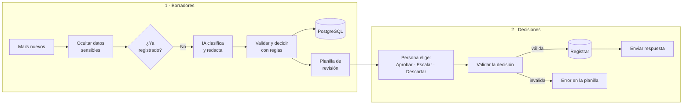

# Mails de soporte con IA y aprobación humana

Workflow de **n8n** que clasifica los mails de atención al cliente, redacta un borrador de respuesta con IA y deja la decisión final en manos de una persona. La IA propone, el código controla los riesgos y nada sale sin aprobación.


https://github.com/user-attachments/assets/96b664d2-a848-4afe-aa7b-138e4917a619


## Qué resuelve

Responder mails de soporte lleva tiempo, y automatizarlo por completo es riesgoso: una IA puede prometer un reembolso, repetir un número de tarjeta o seguir instrucciones escondidas en un mail. Este flujo resuelve la parte repetitiva (leer, clasificar, priorizar y redactar) y le deja a una persona la decisión de qué se envía, con los casos delicados marcados para que no se aprueben sin mirar.

## Cómo funciona



**Parte 1 · Borradores**

1. **Entrada.** La demo usa 10 mails de ejemplo que cubren los casos difíciles: tarjeta en el texto, pedido de reembolso, spam, insultos, amenaza de denuncia, intento de manipular a la IA y un mail en inglés.
2. **Protección de datos.** Antes de que el mail llegue a la IA, se ocultan números de tarjeta y contraseñas, y se marcan riesgos con reglas: amenazas legales, amenazas e intentos de dar instrucciones a la IA.
3. **Sin duplicados.** Se descartan los mails que ya están en la base, para no procesarlos ni pagar la IA dos veces.
4. **IA.** OpenAI clasifica cada mail (consulta, reclamo, cambio o devolución, facturación, spam), define la urgencia, lo resume y redacta un borrador según las políticas de la empresa. La respuesta llega en JSON.
5. **Validación en código.** Se revisan los valores que devolvió la IA, se detectan promesas de reembolsos, descuentos o cosas gratis, se borra cualquier dato sensible del borrador, se calcula la prioridad y se agrega la firma.
6. **Registro y revisión.** Todo queda en PostgreSQL. Lo que necesita respuesta va a una planilla de Google ordenada por prioridad. El spam se descarta solo.

**Parte 2 · Decisiones** (cada 5 minutos)

1. Lee la planilla y toma las filas con una decisión nueva.
2. Valida cada decisión: la respuesta no puede estar vacía, y un mail con marcas sensibles solo se puede aprobar con **Aprobar (revisado)**.
3. Registra la decisión en PostgreSQL. Si la persona editó la respuesta en la planilla, se usa la versión editada.
4. Si está aprobada, envía la respuesta por Gmail.
5. Escribe el resultado en la planilla: fecha y estado, o el motivo del error.

## Decisiones de diseño

- **La IA propone, una persona decide.** Ningún mail se envía sin aprobación. La automatización ahorra el trabajo repetitivo, no el criterio.
- **Las reglas de riesgo van en código, no en el prompt.** El prompt pide no prometer reembolsos, pero el modelo no es determinista. Por eso el código revisa cada borrador y marca las promesas aunque la IA las haya escrito.
- **Datos sensibles fuera de la IA.** Los números de tarjeta y las contraseñas se ocultan antes de llamar al modelo. Tampoco se le envía la dirección de mail del cliente: no la necesita para redactar.
- **Defensa contra manipulación.** El prompt trata el mail como contenido de un tercero, y una regla independiente detecta los intentos de dar instrucciones a la IA. Un mail así no se puede aprobar sin revisión explícita.
- **Dos niveles de aprobación.** *Aprobar* sirve para los casos simples. *Aprobar (revisado)* es obligatorio cuando hay marcas sensibles (legal, datos sensibles, inyección, amenaza o promesa). El sistema obliga a mirar los casos que importan.
- **Tolerancia a fallas.** Si la IA no devuelve un JSON válido, el mail no se pierde: queda en la planilla para responder a mano. El nodo de OpenAI reintenta ante errores temporales.
- **Modo demo.** Mientras está activo, todas las respuestas se envían a un mail de pruebas y no a los clientes.
- **Permisos mínimos.** El usuario de PostgreSQL de n8n solo puede leer, insertar y actualizar la tabla.

## Limitaciones conocidas

- La entrada de la demo son mails de ejemplo. En producción hay que reemplazar el nodo *Mails de ejemplo* por un **Gmail Trigger** y adaptar los campos en *Normalizar y proteger*.
- La respuesta se envía como un mail nuevo con asunto "Re:", no dentro del mismo hilo de la conversación.
- Si se corrige una fila con error, hay que borrar el texto de la columna `procesado` para que se vuelva a procesar.

## Configuración

**Nodo Configuración** (parte 1):

| Campo | Para qué sirve |
| --- | --- |
| `empresa` | Nombre del negocio |
| `descripcion` | Qué vende y a quién |
| `politicas` | Reglas que la IA debe respetar: cambios, envíos, reembolsos, facturación |
| `tono` | Cómo tiene que sonar la respuesta |
| `firma` | Se agrega al final de cada respuesta |

**Nodo Configuración envío** (parte 2):

| Campo | Para qué sirve |
| --- | --- |
| `modo_demo` | Si está activo, las respuestas van al mail de pruebas |
| `email_pruebas` | Dónde llegan las respuestas en modo demo |

## Instalación

**Requisitos:** n8n (probado en la versión 2.43), PostgreSQL, una API key de OpenAI, Google Sheets y Gmail.

1. **Crear la tabla** ejecutando [`schema.sql`](schema.sql). Si n8n se conecta con un usuario sin permiso para crear tablas, crearla con un administrador y después:
   ```sql
   GRANT SELECT, INSERT, UPDATE ON soporte_mails TO usuario_de_n8n;
   ```
2. **Crear la planilla** en Google Sheets y pegar en la primera fila los encabezados de [`planilla_encabezados.csv`](planilla_encabezados.csv). Recomendado: convertir la columna `decision` en una lista desplegable (*Datos → Validación de datos*) con las opciones *Pendiente, Aprobar, Aprobar (revisado), Escalar, Descartar*.
3. **Importar el workflow:** en n8n, *Import from File* y elegir [`mails-soporte-ia.json`](mails-soporte-ia.json).
4. **Conectar las credenciales:** OpenAI, PostgreSQL, Google Sheets y Gmail.
5. **Elegir la planilla** en los nodos *Agregar a la planilla*, *Leer planilla* y *Marcar en la planilla*, con el modo de columnas en *Map Automatically*.
6. **Completar la configuración** con los datos del negocio y tu mail de pruebas.
7. **Probar:**
   - Ejecutar *Procesar mails (manual)*: aparecen 9 filas en la planilla, porque el spam se descarta.
   - Elegir decisiones en la columna `decision`.
   - Ejecutar *Aplicar decisiones (manual)*.
   - Revisar el mail de pruebas y la columna `procesado`.

## Archivos

| Archivo | Contenido |
| --- | --- |
| `mails-soporte-ia.json` | El workflow para importar en n8n |
| `schema.sql` | Tabla del registro de mails |
| `planilla_encabezados.csv` | Encabezados de la planilla de revisión |

## Tecnologías

n8n · OpenAI (gpt-4.1-mini) · PostgreSQL · Google Sheets · Gmail

---

Hecho por **Juan Manuel Parisi** · [LinkedIn](https://www.linkedin.com/in/juan-manuel-parisi-b26a111b2/)
